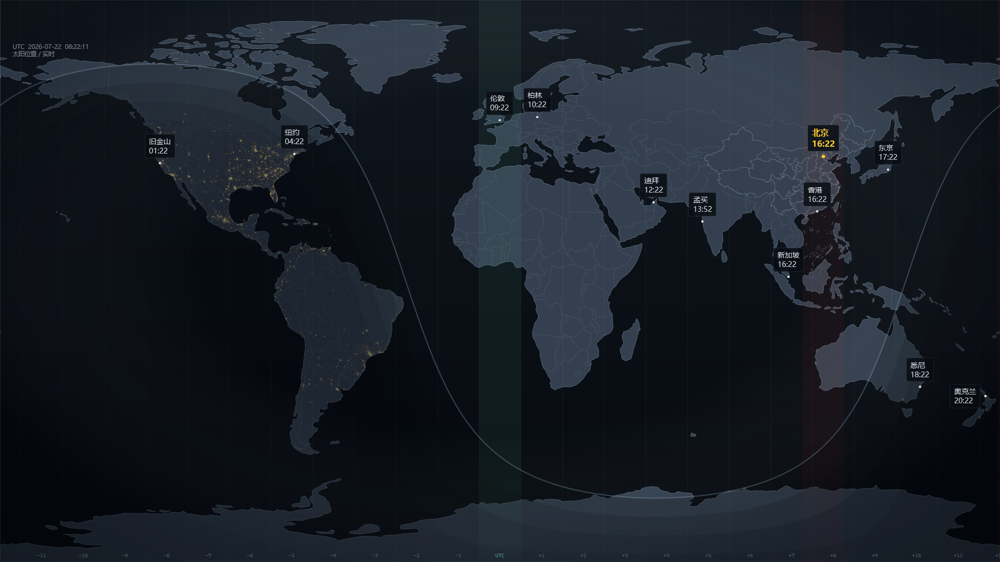

# ThinkTime

> A ThinkPad-inspired live world clock wallpaper for Windows 11.  
> 一款采用经典 ThinkPad 工业美学的 Windows 11 动态世界时钟壁纸。

[简体中文](#简体中文) · [English](#english)

[](LICENSE)



## 简体中文

ThinkTime 把世界时钟、实时晨昏线、时区和卫星夜间灯光组合成一张克制、清晰的桌面地图。它每分钟在本机生成一张新的壁纸并通过 Windows 壁纸接口应用，不会占用桌面图标层，也不会破坏桌面右键菜单和框选操作。

### 主要特性

- **实时太阳模型**：根据当前 UTC 时间绘制昼夜分界与多层曙暮光过渡。
- **夜间灯光**：仅在夜半球显示 NASA Black Marble 地球夜间灯光纹理。
- **全球城市时钟**：显示北京、香港、东京、纽约、伦敦等 12 个城市的当地时间。
- **中国区域细节**：使用单独的中国行政边界覆盖层，并标注北京和香港。
- **稳定的桌面集成**：通过 `IDesktopWallpaper` 更新标准 Windows 壁纸，保留桌面图标、右键菜单和多显示器支持。
- **中英双语**：默认简体中文，可在设置中切换 English。
- **轻量与离线**：地图、纹理和计算全部在本地完成，无网络请求、无遥测。
- **Windows 11 体验**：托盘控制、自定义应用图标、Per-Monitor V2 高 DPI 和清晰字体渲染。

### 下载与运行

前往 [Releases](https://github.com/the1ndex/ThinkTime/releases/latest) 下载 `ThinkTime-1.0.0-win-x64-portable.zip`，解压后直接运行 `ThinkTime.exe`。便携版已经包含 .NET 运行时，不需要另外安装 .NET。

> 当前版本没有商业代码签名证书。Windows SmartScreen 可能在首次运行时显示“未知发布者”，请确认文件来自本仓库的 Release 页面后再运行。

### 快速使用

1. 启动 `ThinkTime.exe`，在主界面预览当前世界地图。
2. 点击右上角 **应用动态壁纸**；之后程序会每 60 秒刷新一次壁纸。
3. 点击齿轮打开设置，可切换语言、12/24 小时制、时区网格、城市标签、强调城市和低功耗模式。
4. 关闭主窗口后可通过系统托盘继续控制；退出托盘程序后自动刷新才会停止。

ThinkTime 更新的是标准桌面壁纸，而不是在桌面后方持续运行视频窗口。这种方式资源占用更低，也能保持 Windows 11 原生桌面交互；相应地，画面以一分钟一次的频率更新。

### 从源码构建

要求：Windows 11、[.NET 8 SDK](https://dotnet.microsoft.com/download/dotnet/8.0) 和 PowerShell。

```powershell
git clone https://github.com/the1ndex/ThinkTime.git
cd ThinkTime
dotnet build ThinkTime.csproj --configuration Release
dotnet run --project ThinkTime.csproj --configuration Release
```

生成自包含的 Windows x64 便携版：

```powershell
dotnet publish ThinkTime.csproj `
  --configuration Release `
  --runtime win-x64 `
  --self-contained true `
  -p:PublishProfile=Properties/PublishProfiles/Portable-x64.pubxml
```

### 本地数据

ThinkTime 不连接服务器，也不收集使用数据。运行时文件位于 `%LOCALAPPDATA%\ThinkTime\`：

- `settings.json`：语言与显示偏好；
- `wallpaper-a.png` / `wallpaper-b.png`：交替写入的壁纸帧；
- `diagnostic.log`：本地诊断日志。

### 许可证

除 [THIRD_PARTY_NOTICES.md](THIRD_PARTY_NOTICES.md) 中单独标注的第三方数据与素材外，ThinkTime 的原创源代码和文档采用 [MIT License](LICENSE)。你可以使用、修改、分发或用于商业项目，但必须保留原始版权与许可声明。

### 技术说明

项目使用 .NET 8 与 WPF，从 GeoJSON 绘制地图，在本地计算太阳位置和晨昏线，通过实时遮罩显示夜间灯光，最后以 PNG 输出到 Windows 壁纸 API。它不使用 WorkerW 窗口嵌入方案，因此桌面右键菜单、图标选择和 Explorer 重启后的恢复行为更可靠。

地图与纹理来源包括 Natural Earth、Alibaba Cloud DataV GeoAtlas 和 NASA Earth Observatory。完整来源、许可与署名见 [THIRD_PARTY_NOTICES.md](THIRD_PARTY_NOTICES.md)。ThinkPad 是 Lenovo 的商标；ThinkTime 是独立项目，与 Lenovo、NASA 或数据提供方不存在隶属或背书关系。

---

## English

ThinkTime combines world clocks, a live solar terminator, time zones, and satellite night lights into a restrained desktop map. It renders a fresh wallpaper locally once per minute and applies it through the Windows wallpaper API, preserving desktop icons, selection, and the normal context menu.

### Features

- **Live solar model** — draws the day/night boundary with layered twilight transitions from the current UTC time.
- **Night lights** — reveals NASA Black Marble imagery only on the astronomical night side.
- **Global city clocks** — shows local time for 12 cities, including Beijing, Hong Kong, Tokyo, New York, and London.
- **China-region detail** — uses a dedicated administrative-boundary overlay with Beijing and Hong Kong labels.
- **Stable desktop integration** — updates the standard Windows wallpaper through `IDesktopWallpaper`, retaining icons, context menus, and multi-monitor support.
- **Bilingual interface** — Simplified Chinese by default, with English available in Settings.
- **Offline and lightweight** — all map assets, textures, and calculations stay on the device; there are no network requests or telemetry.
- **Windows 11 fit and finish** — tray controls, a custom application icon, Per-Monitor V2 DPI awareness, and crisp text rendering.

### Download and run

Download `ThinkTime-1.0.0-win-x64-portable.zip` from [Releases](https://github.com/the1ndex/ThinkTime/releases/latest), extract it, and run `ThinkTime.exe`. The portable build is self-contained and does not require a separate .NET installation.

> The current build is not signed with a commercial code-signing certificate. Windows SmartScreen may show an “Unknown publisher” warning on first launch; verify that the file came from this repository’s Release page before running it.

### Quick start

1. Launch `ThinkTime.exe` to preview the current world view.
2. Select **START LIVE WALLPAPER** in the top-right corner; ThinkTime will refresh the wallpaper every 60 seconds.
3. Open the gear menu to change language, 12/24-hour time, time-zone grid, city labels, accent city, and low-power mode.
4. Closing the main window leaves tray controls available. Automatic refresh stops when the tray application exits.

ThinkTime updates the normal desktop wallpaper instead of keeping a video window behind the desktop. This keeps resource usage low and preserves native Windows 11 desktop behavior; the trade-off is a one-minute animation cadence.

### Build from source

Requirements: Windows 11, the [.NET 8 SDK](https://dotnet.microsoft.com/download/dotnet/8.0), and PowerShell.

```powershell
git clone https://github.com/the1ndex/ThinkTime.git
cd ThinkTime
dotnet build ThinkTime.csproj --configuration Release
dotnet run --project ThinkTime.csproj --configuration Release
```

Publish a self-contained Windows x64 portable build:

```powershell
dotnet publish ThinkTime.csproj `
  --configuration Release `
  --runtime win-x64 `
  --self-contained true `
  -p:PublishProfile=Properties/PublishProfiles/Portable-x64.pubxml
```

### Local data

ThinkTime does not connect to a server or collect usage data. Runtime files are stored under `%LOCALAPPDATA%\ThinkTime\`:

- `settings.json` — language and display preferences;
- `wallpaper-a.png` / `wallpaper-b.png` — alternating rendered wallpaper frames;
- `diagnostic.log` — local diagnostic output.

### License

Except for third-party data and assets identified in [THIRD_PARTY_NOTICES.md](THIRD_PARTY_NOTICES.md), ThinkTime's original source code and documentation are available under the [MIT License](LICENSE). You may use, modify, distribute, or include them in commercial projects, provided that the original copyright and license notice are retained.

### How it works

ThinkTime is built with .NET 8 and WPF. It draws GeoJSON map layers, calculates the Sun and terminator locally, reveals night-light imagery through a live mask, and outputs PNG frames to the Windows wallpaper API. It deliberately avoids WorkerW window embedding, which makes desktop context menus, icon selection, and recovery after Explorer restarts more reliable.

Map and texture sources include Natural Earth, Alibaba Cloud DataV GeoAtlas, and NASA Earth Observatory. See [THIRD_PARTY_NOTICES.md](THIRD_PARTY_NOTICES.md) for full source, licensing, and attribution details. ThinkPad is a trademark of Lenovo; ThinkTime is an independent project and is not affiliated with or endorsed by Lenovo, NASA, or the data providers.
